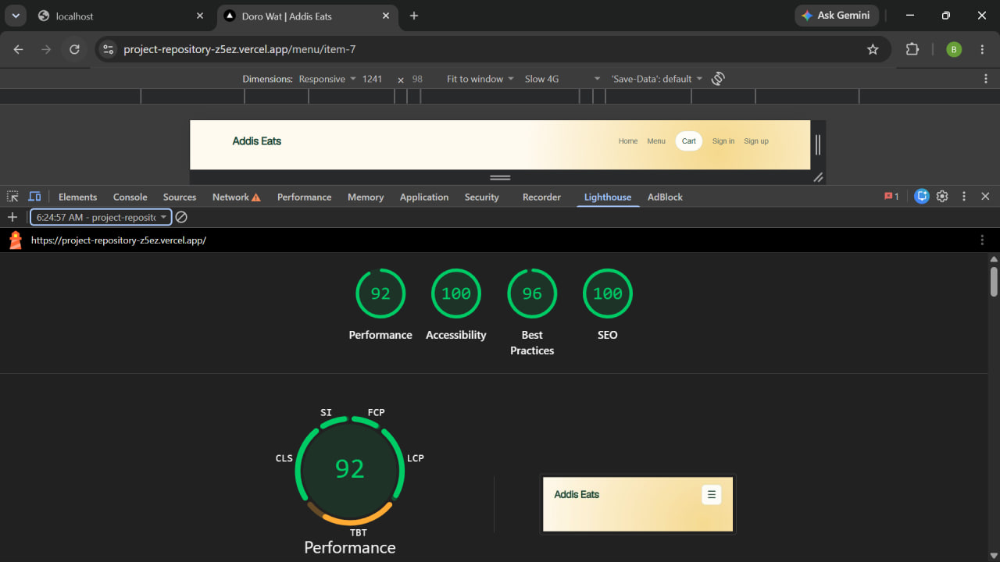
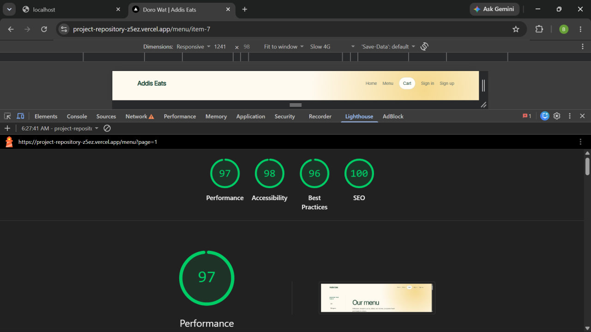
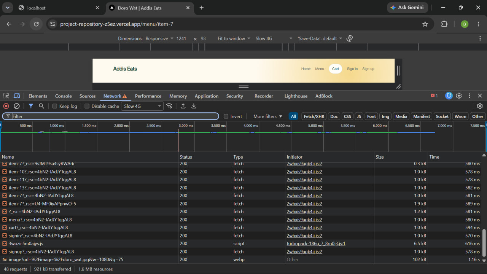

# Performance Decisions and Measurements

## Performance budget

| Metric | Budget   | Baseline                                                                | Optimized                                                               | Cause of change                                                                                                                                                                                                         |
| ------ | -------- | ----------------------------------------------------------------------- | ----------------------------------------------------------------------- | ----------------------------------------------------------------------------------------------------------------------------------------------------------------------------------------------------------------------- |
| LCP    | ≤ 2.5 s  | 0.871 s                                                                 | 0.700 s                                                                 | The global SWR provider was removed; fetcher configuration now lives only in the search and order-status components that use SWR. In the audited home route, transferred JavaScript fell from 154,387 to 148,329 bytes. |
| CLS    | ≤ 0.1    | 0.000                                                                   | 0.000                                                                   | No observed layout shift in either run; explicit image dimensions and `next/font` remain in place.                                                                                                                      |
| INP    | ≤ 200 ms | Not available in Lighthouse navigation run (no interaction field data). | Not available in Lighthouse navigation run (no interaction field data). | INP requires real interaction data; Lighthouse navigation metrics do not produce a valid INP value. Do not substitute TBT.                                                                                              |

## Mobile performance

## Desktop performance

## Network throttle Slow 4G

## Changes and expected effect

- The home hero now uses `next/image` for the local 1024 × 732 Doro Wot image,
  provides responsive `sizes`, and is the sole prioritized image. Other menu
  images retain lazy loading and declare their actual source dimensions and
  responsive display sizes. These changes let Next.js serve appropriate
  optimized image variants and reserve the intended layout space.
- The root layout uses `next/font/local` with the self-hosted Geist font. It
  removes reliance on a runtime font request to a third-party provider and
  uses `display: swap`. The font's bundled MPL-2.0 license is included beside
  the font source.
- No third-party scripts or remote images are currently used. Therefore there
  is no script to move to `next/script`, and `next.config.mjs` does not need
  remote image host entries.

Both measurements used Lighthouse 13.5 against the local production build at
`http://localhost:3340/`, with desktop simulated throttling and the performance
category. LCP improved from 0.871 s to 0.700 s, while TBT changed from 16.5 ms
to 11.5 ms and Speed Index from 1.010 s to 0.455 s. Lighthouse still reports
29.5 KiB of estimated unused JavaScript in the same shared chunk, so the
provider change did not resolve that separate opportunity. INP was unavailable
because neither navigation run had field interaction data.
